# POWERMAC CONNECT - Architecture

*One Connected Operation. Complete Business Intelligence.*
A multi-tenant operating system for construction and property-maintenance contractors, built by BPOAI.AI,
first implemented for PowerMac Joinery & Construction (Scotland).

## 1. Repository inspection (starting point)

The repository `jc-roofing-leadgen` contained a live, unrelated product: the JC Roofing quote-and-booking app
(Next.js 16, JSON/Supabase key-value storage, deployed from the repository root). PowerMac Connect was therefore
built as a **self-contained application in `powermac-connect/`** with its own `package.json`, so the JC Roofing
deployment is untouched (the root `tsconfig.json` and ESLint config only gained an exclusion for the new folder).
For production it should move to its own repository (`git subtree split --prefix powermac-connect`).

## 2. Architecture

```
 Browser (desktop command centre, mobile field app, client portal)
   │  HTTPS, HTTP-only session cookies
   ▼
 Next.js 16 (App Router) on Vercel / any Node host
   ├─ proxy.ts ............ refreshes the Supabase session, idle sign-out, sends anonymous users to /login
   ├─ Server Components ... read data AS THE USER (Supabase client bound to their session)
   ├─ Server Actions ...... every write: permission guard -> zod validation -> insert/update -> revalidate
   ├─ lib/auth/context.ts . request-scoped access context: memberships, active company, role permissions
   └─ server-only modules . service-role client (Auth admin only), email, AI (Stage 6), integrations
   │
   ▼
 Supabase (PostgreSQL 17 + Auth + Storage + PostgREST)
   ├─ 73 tables, all with Row Level Security (default deny), composite tenant foreign keys
   ├─ RBAC: permissions catalogue -> per-tenant roles -> memberships (with scope: staff/client/operative/...)
   ├─ Triggers: audit log, reference numbers, workflow enforcement, escalation guards, derived totals
   ├─ SECURITY INVOKER reporting functions (dashboard, alerts, performance, scheduling recommendations)
   └─ Private storage buckets (documents, photos) namespaced by tenant id
```

**Why this shape**
- *Database-enforced security.* Permissions are checked in the UI for convenience, in Server Actions for
  correctness, and in PostgreSQL (RLS + triggers) as the final authority. A bug in a page cannot leak another
  company's data or let someone approve their own work.
- *Thin server, rich database.* Business rules that must hold for every channel (UI, API intake, AI, future
  mobile app) live in the database: job workflow transitions, approvals, totals, stock levels, audit.
- *No unnecessary dependencies.* Next.js, React, Supabase, zod, lucide-react, Leaflet. Charts, drag-and-drop,
  tables and forms are small in-house components.
- *Ready for a React Native app.* The mobile app can use the same Supabase Auth and the same RPC/RLS contract;
  nothing depends on Next.js-only state.

## 3. Multi-tenancy

| Concept | Implementation |
|---|---|
| Tenant | `tenants` row = one customer company of BPOAI.AI (`plan_key`, `subscription_status`, `seats`, `is_demo`) |
| Isolation | every business table has `tenant_id`; RLS policies use `tenant_id in (select app.internal_perm_tenants('<perm>'))` |
| Cross-tenant integrity | `unique (tenant_id, id)` on every table + **composite foreign keys** `(tenant_id, x_id)` so a row can never reference another tenant's row (proven by a test with triggers disabled) |
| Users in several companies | `memberships (tenant_id, user_id)`; active company chosen in the sidebar switcher |
| Suspended subscriptions | membership helpers ignore tenants not in `trial/active/past_due`, so access stops at once |
| BPOAI.AI super admin | `profiles.is_platform_admin`: manages tenants, plans and subscriptions via `platform_*` functions; does **not** see company data unless given a membership (UK GDPR: processor, least privilege) |

## 4. Roles and permissions

53 permissions (`module.action`, e.g. `work_orders.approve`) are granted to **per-tenant roles**; each role has a
*scope*:

| Scope | Default roles | Data access |
|---|---|---|
| internal | Company Director, Operations Manager, Contract Manager, Office Administrator, Finance Manager | base tables via RLS, by permission |
| client | Corporate Client | own organisation only, through narrow portal functions (Stage 4) |
| operative | Field Operative | own assignments only, through field functions (Stage 4) |
| subcontractor | Subcontractor | authorised assignments only (Stage 4) |
| occupant | Tenant / Occupant | own property's repairs only, when enabled (Stage 4) |

Roles are editable in **Settings -> Roles & permissions**. Guards in the database: nobody can change their own
role/status, grant a permission they do not hold, edit their own role's permissions, or remove the last user
manager. Sensitive data has separate permissions: `occupants.read` (residents), `workforce.pii` (employee
personal data and pay), `finance.read`.

## 5. Database relationship model

```mermaid
erDiagram
  TENANTS ||--o{ MEMBERSHIPS : has
  PROFILES ||--o{ MEMBERSHIPS : "user in"
  ROLES ||--o{ MEMBERSHIPS : grants
  ROLES ||--o{ ROLE_PERMISSIONS : has
  PERMISSIONS ||--o{ ROLE_PERMISSIONS : in
  TENANTS ||--o{ ORGANISATIONS : "clients of"
  ORGANISATIONS ||--o{ CONTACTS : has
  ORGANISATIONS ||--o{ CRM_OPPORTUNITIES : pipeline
  ORGANISATIONS ||--o{ CRM_ACTIVITIES : history
  ORGANISATIONS ||--o{ CONTRACTS : commissions
  CONTRACTS ||--o{ CONTRACT_SLAS : defines
  CONTRACTS ||--o{ CONTRACT_KPIS : measures
  CONTRACTS ||--o{ CONTRACT_VARIATIONS : changes
  CONTRACTS }o--o{ PROPERTIES : "contract_properties"
  ORGANISATIONS ||--o{ PROPERTIES : owns
  PROPERTIES ||--o{ OCCUPANTS : "lived in by"
  PROPERTIES ||--o{ WORK_ORDERS : "work at"
  CONTRACTS ||--o{ WORK_ORDERS : "work under"
  PROJECTS ||--o{ WORK_ORDERS : groups
  WORK_ORDERS ||--o{ JOB_ASSIGNMENTS : "allocated by"
  EMPLOYEES ||--o{ JOB_ASSIGNMENTS : works
  SUBCONTRACTORS ||--o{ JOB_ASSIGNMENTS : works
  WORK_ORDERS ||--o{ JOB_UPDATES : timeline
  WORK_ORDERS ||--o{ PHOTOS : evidence
  WORK_ORDERS ||--o{ JOB_MATERIALS : uses
  WORK_ORDERS ||--o{ TIMESHEETS : labour
  WORK_ORDERS ||--o{ INSPECTIONS : checked
  EMPLOYEES ||--|| EMPLOYEE_PRIVATE : "personal data"
  EMPLOYEES ||--o{ QUALIFICATIONS : holds
  EMPLOYEES ||--o{ EMPLOYEE_ABSENCES : availability
  VEHICLES ||--o{ EMPLOYEES : allocated
  SUPPLIERS ||--o{ PURCHASE_ORDERS : fulfils
  PURCHASE_ORDERS ||--o{ PURCHASE_ORDER_LINES : contains
  WORK_ORDERS ||--o{ PURCHASE_ORDERS : "traceable to"
  MATERIALS ||--o{ STOCK_MOVEMENTS : ledger
  STOCK_LOCATIONS ||--o{ STOCK_LEVELS : holds
  WORK_ORDERS ||--o{ QUOTATIONS : priced
  QUOTATIONS ||--o{ QUOTATION_LINES : lines
  WORK_ORDERS ||--o{ INVOICES : billed
  INVOICES ||--o{ PAYMENTS : settled
  WORK_ORDERS ||--o{ COSTS : "cost ledger"
  CONTRACTS ||--o{ COSTS : "cost ledger"
  PROPERTIES ||--o{ CERTIFICATES : compliance
  TENANTS ||--o{ DOCUMENTS : stores
  TENANTS ||--o{ COMMUNICATIONS : logs
  TENANTS ||--o{ AUTOMATION_WORKFLOWS : rules
  AUTOMATION_WORKFLOWS ||--o{ AUTOMATION_RUNS : executions
  TENANTS ||--o{ INBOUND_MESSAGES : "email/API intake"
  TENANTS ||--o{ AI_ACTIVITY : "AI log"
  TENANTS ||--o{ AUDIT_LOGS : "audit trail"
```



Migrations (`supabase/migrations/`): `0100` platform & RBAC & audit · `0200` CRM, contracts, properties, occupants ·
`0300` workforce, subcontractors, projects, work orders · `0400` suppliers, stock, purchasing, quotes, invoices, costs ·
`0500` documents, certificates, communications, notifications, automation, intake, AI, integrations, retention ·
`0600` RLS registry, grants, approvals, workflow enforcement, provisioning, storage, retention job · `0700`
invitations · `0800` reporting & scheduling intelligence.

Key rules implemented in the database:
- **Configurable job workflow**: 13 default statuses (+ cancelled) and the allowed moves between them, each move
  optionally requiring a permission (e.g. *Awaiting approval -> Approved* needs `work_orders.approve`). Every
  status change is written to the job timeline automatically.
- **Derived values are never typed**: document totals from lines, invoice paid/overdue from payments, labour
  cost from timesheets x protected pay rate, stock levels from the movement ledger, job schedule window from
  assignments. Column-level grants stop users writing approval stamps or totals directly.
- **Traceability**: purchase orders and their lines carry job and contract; costs inherit the contract from the
  job, so contract profitability is complete.
- **Audit**: append-only `audit_logs` written by triggers on every business table; personal-data values are
  redacted (the fact of a change is kept).

## 6. Navigation and screens

| Area | Route | Stage | Status |
|---|---|---|---|
| Sign in, reset password, accept invitation | `/login`, `/forgot-password`, `/auth/*` | 1 | built |
| Command centre | `/dashboard` | 2 | built |
| Clients & CRM, pipeline, follow-ups | `/crm`, `/crm/[id]`, `/crm/pipeline`, `/crm/follow-ups` | 2 | built |
| Contracts | `/contracts`, `/contracts/[id]` | 2 | built |
| Properties (list + map) | `/properties`, `/properties/[id]` | 2 | built |
| Jobs (board, list, calendar, map, bulk, intake) | `/jobs`, `/jobs/new`, `/jobs/bulk`, `/jobs/[id]` | 3 | built |
| Schedule (drag-and-drop planner) | `/schedule` | 3 | built |
| Workforce & vehicles, subcontractors | `/workforce`, `/subcontractors` | 3 | built |
| Settings: profile, company, users, roles, workflow, picklists, integrations, retention, audit | `/settings/*` | 1 | built |
| BPOAI.AI platform console | `/platform` | 1 | built |
| Field operative mobile app (offline) | `/field` | 4 | next |
| Corporate client & tenant portal | `/portal` | 4 | next |
| Suppliers, purchasing, stock, quotations, invoicing, finance | `/procurement`, `/finance` | 5 | schema ready |
| PowerMac AI assistant, automation engine | `/ai`, `/settings/automations` | 6 | schema ready |
| Accounting, email, WhatsApp integrations; security testing; deployment | - | 7 | interfaces ready |

The sidebar only shows modules the user's role can use; nothing links to an unbuilt screen.

## 7. Environment variables

| Variable | Where | Required | Purpose |
|---|---|---|---|
| `NEXT_PUBLIC_SUPABASE_URL` | server + browser | yes | Supabase project URL |
| `NEXT_PUBLIC_SUPABASE_ANON_KEY` | server + browser | yes | public (anon/publishable) key - safe because of RLS |
| `SUPABASE_SERVICE_ROLE_KEY` | server only | yes for invitations | used only for Supabase Auth admin calls |
| `NEXT_PUBLIC_SITE_URL` | server | yes | absolute links in emails (e.g. `https://connect.powermac.co.uk`) |
| `SESSION_IDLE_MINUTES` | server | no (480) | sign out after inactivity |
| `RESEND_API_KEY`, `EMAIL_FROM` | server | no | outbound email; without them links are shown to the sender (preview) |
| `OPENAI_API_KEY`, `OPENAI_MODEL` | server | Stage 6 | PowerMac AI |
| `TWILIO_*` / `WHATSAPP_*` | server | Stage 7 | SMS / WhatsApp Business |
| `XERO_CLIENT_ID` / `XERO_CLIENT_SECRET` (or QuickBooks/Sage) | server | Stage 7 | accounting sync |
| `CRON_SECRET` | server | Stage 6/7 | scheduled jobs (retention, reminders, reports) |

## 8. External integration dependencies

| Integration | Used for | Without it |
|---|---|---|
| Supabase | database, auth, storage | required |
| OpenStreetMap tiles, postcodes.io | maps, UK postcode geocoding (free, no key) | maps show without tiles |
| Resend (or any SMTP via Supabase Auth) | invitations, notifications | preview mode |
| OpenAI | AI features (server-side only, human approval for sensitive actions) | AI hidden |
| Xero / QuickBooks / Sage | invoice & payment sync - PowerMac Connect does not replace the ledger | export only |
| Twilio / Meta WhatsApp | messaging | messages logged as preview |

## 9. Delivery stages

1. **Project setup, architecture, database, authentication, design system** - done
2. **Command centre, CRM, contracts, property management** - done
3. **Work order engine, job management, scheduling, workforce** - done
4. Mobile operative app (offline sync) and client portal
5. Suppliers, procurement, stock, quotations, invoicing, financial intelligence
6. PowerMac AI assistant and automation engine
7. Integrations, security testing, deployment

See `docs/SECURITY.md` for the UK GDPR controls and `docs/DEPLOYMENT.md` to go live.
